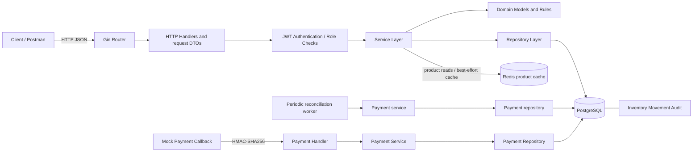
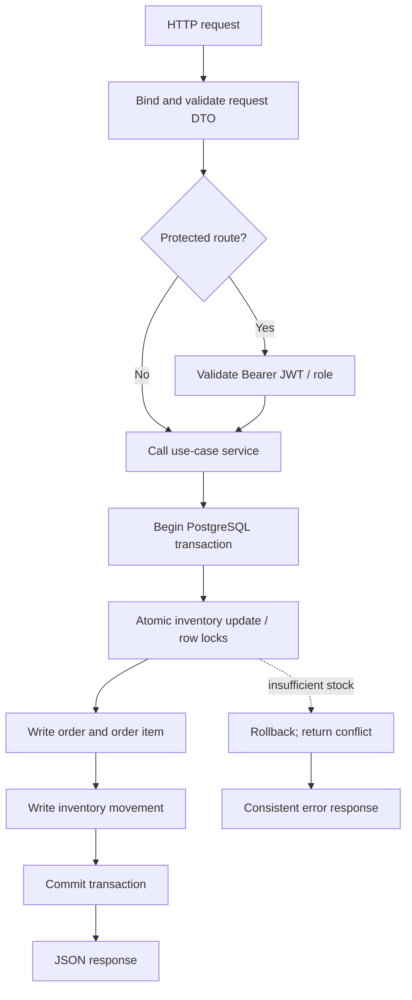
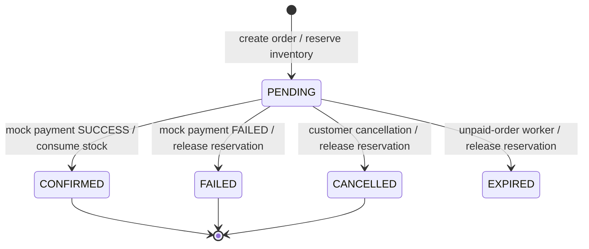

# OrderFlow — Go E-commerce Backend

OrderFlow is a REST backend for a small e-commerce/order-processing workflow. It is written in Go with Gin, PostgreSQL and `pgx`. The current payment gateway is deliberately a **mock provider** with an HMAC-signed callback; this repository does not yet contain a live Stripe integration or an AWS deployment.

> **Implementation milestone:** Redis product-read caching, TTL-based expiration, versioned invalidation, a periodic reconciliation reporter, and a Docker runtime smoke test are included in this change bundle. They must pass the repository workflow after the bundle is committed; do not treat a local ZIP as proof of a green CI run.

## What is implemented

- Registration and login with bcrypt password hashing and 24-hour HS256 JWTs.
- Public product listing/search/detail and ADMIN-only create/update/deactivate.
- Authenticated order creation, per-user order history/detail and cancellation.
- Transactional inventory reservation; inventory receipts/adjustments and movement audit history.
- Mock payment initiation with idempotency keys, HMAC-SHA256 callback validation, replay-safe status transitions, and an admin reconciliation report.
- Health/readiness endpoints and PostgreSQL-backed integration tests, including concurrent order/payment scenarios.
- Optional Redis-backed product list/detail cache with a 60-second default TTL and generation-based invalidation after product create/update/deactivation.
- Configurable read-only reconciliation worker that periodically logs stale pending payments or inconsistent order/payment states.
- CI now tests a disposable PostgreSQL database and Redis, builds the Docker image, and smoke-tests `/health` and `/ready` inside the container.

## Architecture at a glance (HLD)



The Redis cache is optional and fail-open: PostgreSQL remains the source of truth. The scheduled reconciliation worker is read-only and reports issues to application logs; it does not automatically settle payments. This diagram represents source structure, not a claim that the system is deployed to AWS. The editable diagram sources are in [`docs/diagrams/HLD.mmd`](docs/diagrams/HLD.mmd) and [`docs/diagrams/LLD.mmd`](docs/diagrams/LLD.mmd).

## Low-level design (LLD)



### Order and payment state flow



## Package structure and design patterns

| Location | Responsibility |
|---|---|
| `cmd/api/main.go` | Composition root, HTTP server lifecycle, graceful shutdown |
| `internal/config` | Environment configuration |
| `internal/http` | Gin routes, request binding, auth middleware and HTTP status mapping |
| `internal/domain` | JSON response/domain types and use-case input types |
| `internal/service` | Business validation, transaction orchestration, state rules and product cache-aside logic |
| `internal/repository` | PostgreSQL persistence, query isolation and transaction operations |
| `internal/database` | `pgxpool` connection setup |
| `migrations` | Versioned SQL schema changes |
| `internal/integration` | Real PostgreSQL integration and concurrency tests (including optional Redis invalidation test) |
| `internal/cache` | Redis adapter for product read caching |
| `internal/worker` | Periodic read-only payment reconciliation reporting |

The existing code already has domain models, request DTO structs (private to the relevant HTTP handler files), repository implementations and services. A separate DTO package is not required for correctness; creating duplicate model/DTO/repository layers would add indirection without adding functionality. See [`docs/DESIGN_PATTERNS.md`](docs/DESIGN_PATTERNS.md) for code-reading guidance.

## Prerequisites

- Go version compatible with `go.mod` (`go 1.26.0` at the remote-review baseline).
- Docker Desktop / Docker Engine with Compose.
- PostgreSQL client (`psql`) for applying the initial migrations.
- A local `.env` file copied from `.env.example`.

## Local setup

1. Start the PostgreSQL container:

   ```bash
   docker compose up -d postgres
   docker compose ps
   ```

2. Copy `.env.example` to `.env`; replace example values locally. Generate independent random secrets (do not commit `.env`):

   ```bash
   cp .env.example .env
   openssl rand -hex 32
   ```

   Put one generated value in `JWT_SECRET` and a different generated value in `MOCK_PAYMENT_WEBHOOK_SECRET`. The PostgreSQL port exposed by Compose is `5433`; the default example URL must match your local container credentials.

3. For a **fresh empty development database only**, load the local variables and apply migrations in order:

   ```bash
   set -a; . ./.env; set +a
   for migration in migrations/*.up.sql; do
     echo "Applying $migration"
     psql "$DATABASE_URL" -v ON_ERROR_STOP=1 -f "$migration" || exit 1
   done
   ```

   Do **not** rerun this initial-migration loop on the already-migrated `orderflow` database. For the separate integration database, follow [`INTEGRATION_TESTING_MILESTONE.md`](INTEGRATION_TESTING_MILESTONE.md); `orderflow_test` is already initialized on the author's current local setup.

4. Run the API from the repository root:

   ```bash
   go mod download
   go run ./cmd/api
   ```

5. Verify health and database readiness:

   ```bash
   curl -i http://localhost:8080/health
   curl -i http://localhost:8080/ready
   ```

   Expected success bodies are `{"status":"ok"}` and `{"status":"ready"}` respectively.

## Tests and static checks

```bash
go test ./...
go test -race ./internal/integration/...
go vet ./...
git diff --check
```

For the PostgreSQL-backed suite, set `ORDERFLOW_TEST_DATABASE_URL` to the dedicated database whose name is exactly `orderflow_test`, then run `./scripts/run-integration-tests.sh`. The test helper refuses any other database name. Never point it at development or production data.

## API documentation / Swagger UI

The OpenAPI 3.0 contract is [`docs/openapi.yaml`](docs/openapi.yaml). The request examples and variable workflow are in [`docs/postman/OrderFlow.postman_collection.json`](docs/postman/OrderFlow.postman_collection.json). This repository does not currently mount a `/swagger` or `/docs` API route; use the spec with Swagger UI locally:

```bash
docker run --rm -p 8081:8080 \
  -e SWAGGER_JSON=/spec/openapi.yaml \
  -v "$PWD/docs/openapi.yaml:/spec/openapi.yaml:ro" \
  swaggerapi/swagger-ui
```

Open `http://localhost:8081`. This runs Swagger UI as a separate container and does not add a dependency to the Go API.

## HTTP route summary

| Method | Path | Access | Purpose |
|---|---|---|---|
| GET | `/health` | Public | Process health |
| GET | `/ready` | Public | PostgreSQL readiness |
| POST | `/auth/register` | Public | Register CUSTOMER |
| POST | `/auth/login` | Public | Get JWT |
| GET | `/profile` | Bearer JWT | Current user ID and role |
| POST | `/admin/example` | ADMIN | Example protected route |
| GET | `/products` | Public | Search/paginate active products |
| GET | `/products/{id}` | Public | Get active product |
| POST | `/products` | ADMIN | Create product and initial inventory |
| PATCH | `/products/{id}` | ADMIN | Update product fields |
| DELETE | `/products/{id}` | ADMIN | Deactivate product (not hard-delete) |
| GET | `/inventory/{product_id}` | Public | On-hand/reserved/available quantities |
| POST | `/admin/inventory/receipts` | ADMIN | Receive stock |
| POST | `/admin/inventory/adjustments` | ADMIN | Adjust stock with a reason |
| GET | `/admin/inventory/movements` | ADMIN | Filter/paginate audit movements |
| POST | `/orders` | Bearer JWT | Create order / reserve stock |
| GET | `/orders` | Bearer JWT | Current user's order list |
| GET | `/orders/{id}` | Bearer JWT | Current user's order detail |
| POST | `/orders/{id}/cancel` | Bearer JWT | Cancel PENDING order |
| POST | `/orders/{id}/payments` | Bearer JWT + `Idempotency-Key` | Initiate mock payment |
| POST | `/payments/mock-callback` | HMAC-signed request | Mock provider callback |
| GET | `/admin/payments/reconciliation` | ADMIN | List payment/order inconsistencies |

Full request/response schemas and status codes are in the OpenAPI file.

## Important implementation boundaries

- Money is represented as integer paise (`price_paise`, `amount_paise`), not floating-point rupees.
- Product deletion is soft deactivation; inactive products are not returned by public active-product reads.
- `available_quantity = on_hand_quantity - reserved_quantity`.
- Order creation reserves inventory inside the same PostgreSQL transaction that writes order, item and movement rows. A failed operation rolls back those writes.
- The mock payment callback signs the **exact raw request-body bytes** using HMAC-SHA256 and expects `X-Mock-Signature: sha256=<hex>`. Use the mock webhook secret; this is not a Stripe signature verifier.
- A successful mock payment confirms the order and consumes both on-hand and reserved stock with an ORDER_FULFILLED audit movement. A failed payment records a reason, marks the order FAILED and releases the reservation once.
- Admin creation is not exposed as a public registration role; registered accounts start as CUSTOMER. For a local admin demo, promote a dedicated test user manually in the local database. Never expose a production database to a demo workflow.

## Redis and scheduled reconciliation

Redis is an optional acceleration layer for `GET /products` and `GET /products/{id}`. Cache entries use a generation-numbered namespace and TTL; product create/update/deactivation increments the generation so new reads cannot reuse prior-generation keys. If Redis is unavailable at startup, the API stays operational and falls back to PostgreSQL. `REDIS_DB` must be 0–15; use separate disposable databases for tests.

A configurable background worker runs the existing reconciliation report periodically and logs each issue. It is read-only; it does not mutate payments/orders or replace a real provider reconciliation process. Set `RECONCILIATION_INTERVAL_SECONDS=0` to disable the worker.

## Docker build and runtime smoke test

The GitHub Actions workflow now starts disposable PostgreSQL and Redis services, runs migrations, executes unit/integration tests and race checks, builds the image, then starts the container and probes `/health` and `/ready`. The green workflow run is the evidence of success; a local Docker build still needs to be executed if the assessment specifically requires a screenshot from the developer machine.

## Finalization status

Core Go APIs, models, services, repositories, migrations and automated tests are implemented. Redis caching and scheduled read-only reconciliation are included; apply migration 000007 and verify the new reliability suite and CI before claiming that milestone as complete. A live payment provider and AWS deployment are not claimed here. Track evidence in [`docs/SCREENSHOT_CHECKLIST.md`](docs/SCREENSHOT_CHECKLIST.md) and remaining work in [`docs/REMOTE_REVIEW_AND_REMAINING_WORK.md`](docs/REMOTE_REVIEW_AND_REMAINING_WORK.md).


## Screenshot evidence and report

The exact screenshot runbook is in [`docs/evidence/README.md`](docs/evidence/README.md). The report source is maintained in `docs/PROJECT_REPORT.md`. A local DOCX/PDF working draft may exist under `submission/`, but those `*_DRAFT.*` files are intentionally ignored by Git and are not the final submission. Generate the submission report after final verification, actual benchmark measurements and the end-of-project evidence session.

## Residual code milestone (not yet verified on every developer machine)

The reliability overlay additionally supports multi-product order requests, order-request idempotency, callback amount/currency validation and failure reasons, stock consumption on successful payment, safe unpaid-order expiry, and admin reporting. Run `scripts/verify-residual-milestone.sh`, then `scripts/docker-smoke-test.sh` and `scripts/benchmark-product-cache.sh`. These changes are not complete until the new tests pass and the new HEAD's GitHub Actions run is green. The benchmark must be run on your own environment; record measured values only. AWS deployment and real payment-provider status lookup remain external/environment-dependent work.


## Reliability extensions (current completion bundle)

- `POST /orders` accepts one legacy `product_id`/`quantity` payload or an `items` array of 1–50 distinct products. A required `Idempotency-Key` replays an identical request and returns 409 if the same key is reused with a different payload.
- A valid successful mock-payment callback verifies the persisted amount and currency, marks the order `CONFIRMED`, consumes on-hand and reserved stock, and writes an `ORDER_FULFILLED` movement in one database transaction. A failed callback records `failure_reason` and releases reservations.
- A periodic worker expires old `PENDING` orders only when there is no `PENDING` or `SUCCESS` payment. It deliberately does not expire an unresolved payment because the provider may have charged and the callback may be delayed.
- Admin reports: `GET /admin/reports/orders`, `GET /admin/reports/sales?from=YYYY-MM-DD&to=YYYY-MM-DD`, and `GET /admin/reports/inventory?low_stock_threshold=5`.
- `scripts/benchmark-api-cache.sh` measures actual `GET /products` p50/p95/mean latency and throughput with Redis disabled/enabled under a repeatable local request load; results are saved under `docs/evidence/performance/`. `scripts/benchmark-product-cache.sh` additionally compares repository-layer PostgreSQL and warm Redis list reads. Use measured outputs only.

Apply new schema changes once to both your local development DB and the dedicated test DB by following `docs/RESIDUAL_MILESTONE.md`. Never point `ORDERFLOW_TEST_DATABASE_URL` at `orderflow` or production. The current payment integration is deliberately a mock provider; a real provider lookup is needed before reconciliation can automatically repair a missed callback.

Admin reporting is available at `GET /admin/reports/orders`, `GET /admin/reports/sales` and `GET /admin/reports/inventory`; all require an ADMIN bearer token.
