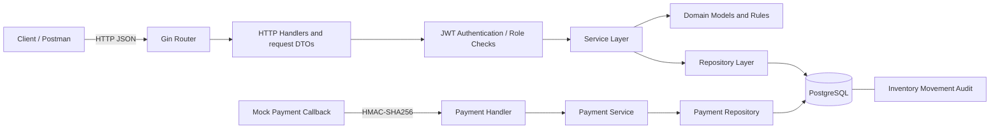
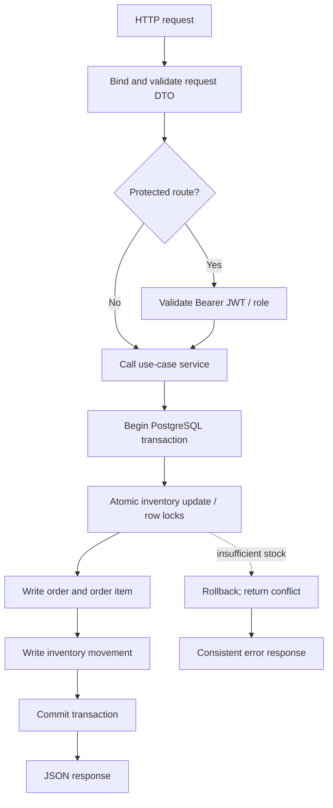
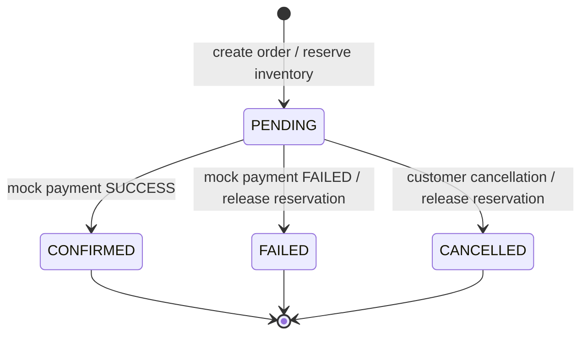

# OrderFlow — Go E-commerce Backend

OrderFlow is a REST backend for a small e-commerce/order-processing workflow. It is written in Go with Gin, PostgreSQL and `pgx`. The current payment gateway is deliberately a **mock provider** with an HMAC-signed callback; this repository does not yet contain a live Stripe integration or an AWS deployment.

> **Remote review baseline:** `8ffd04e` — `test: cover concurrent orders and payment callbacks`. The owner ran `go test ./...`, `go test -race ./internal/integration/...`, `go vet ./...`, and `git diff --check` successfully at that baseline. The new CI workflow below has not been run by GitHub until pushed.

## What is implemented

- Registration and login with bcrypt password hashing and 24-hour HS256 JWTs.
- Public product listing/search/detail and ADMIN-only create/update/deactivate.
- Authenticated order creation, per-user order history/detail and cancellation.
- Transactional inventory reservation; inventory receipts/adjustments and movement audit history.
- Mock payment initiation with idempotency keys, HMAC-SHA256 callback validation, replay-safe status transitions, and an admin reconciliation report.
- Health/readiness endpoints and PostgreSQL-backed integration tests, including concurrent order/payment scenarios.

## Architecture at a glance (HLD)



The diagram represents the current source structure, not a claim that the system is deployed to AWS. The editable diagram sources are in [`docs/diagrams/HLD.mmd`](docs/diagrams/HLD.mmd) and [`docs/diagrams/LLD.mmd`](docs/diagrams/LLD.mmd).

## Low-level design (LLD)



### Order and payment state flow



## Package structure and design patterns

| Location | Responsibility |
|---|---|
| `cmd/api/main.go` | Composition root, HTTP server lifecycle, graceful shutdown |
| `internal/config` | Environment configuration |
| `internal/http` | Gin routes, request binding, auth middleware and HTTP status mapping |
| `internal/domain` | JSON response/domain types and use-case input types |
| `internal/service` | Business validation, transaction orchestration and state rules |
| `internal/repository` | PostgreSQL persistence, query isolation and transaction operations |
| `internal/database` | `pgxpool` connection setup |
| `migrations` | Versioned SQL schema changes |
| `internal/integration` | Real PostgreSQL integration and concurrency tests |

The existing code already has domain models, request DTO structs (private to the relevant HTTP handler files), repository implementations and services. A separate DTO package is not required for correctness; creating duplicate model/DTO/repository layers would add indirection without adding functionality. See [`docs/DESIGN_PATTERNS.md`](docs/DESIGN_PATTERNS.md) for code-reading guidance.

## Prerequisites

- Go version compatible with `go.mod` (`go 1.26.0` at the remote-review baseline).
- Docker Desktop / Docker Engine with Compose.
- PostgreSQL client (`psql`) for applying the initial migrations.
- A local `.env` file copied from `.env.example`.

## Local setup

1. Start the PostgreSQL container:

   ```bash
   docker compose up -d postgres
   docker compose ps
   ```

2. Copy `.env.example` to `.env`; replace example values locally. Generate independent random secrets (do not commit `.env`):

   ```bash
   cp .env.example .env
   openssl rand -hex 32
   ```

   Put one generated value in `JWT_SECRET` and a different generated value in `MOCK_PAYMENT_WEBHOOK_SECRET`. The PostgreSQL port exposed by Compose is `5433`; the default example URL must match your local container credentials.

3. For a **fresh empty development database only**, load the local variables and apply migrations in order:

   ```bash
   set -a; . ./.env; set +a
   for migration in migrations/*.up.sql; do
     echo "Applying $migration"
     psql "$DATABASE_URL" -v ON_ERROR_STOP=1 -f "$migration" || exit 1
   done
   ```

   Do **not** rerun this initial-migration loop on the already-migrated `orderflow` database. For the separate integration database, follow [`INTEGRATION_TESTING_MILESTONE.md`](INTEGRATION_TESTING_MILESTONE.md); `orderflow_test` is already initialized on the author's current local setup.

4. Run the API from the repository root:

   ```bash
   go mod download
   go run ./cmd/api
   ```

5. Verify health and database readiness:

   ```bash
   curl -i http://localhost:8080/health
   curl -i http://localhost:8080/ready
   ```

   Expected success bodies are `{"status":"ok"}` and `{"status":"ready"}` respectively.

## Tests and static checks

```bash
go test ./...
go test -race ./internal/integration/...
go vet ./...
git diff --check
```

For the PostgreSQL-backed suite, set `ORDERFLOW_TEST_DATABASE_URL` to the dedicated database whose name is exactly `orderflow_test`, then run `./scripts/run-integration-tests.sh`. The test helper refuses any other database name. Never point it at development or production data.

## API documentation / Swagger UI

The OpenAPI 3.0 contract is [`docs/openapi.yaml`](docs/openapi.yaml). The request examples and variable workflow are in [`docs/postman/OrderFlow.postman_collection.json`](docs/postman/OrderFlow.postman_collection.json). This repository does not currently mount a `/swagger` or `/docs` API route; use the spec with Swagger UI locally:

```bash
docker run --rm -p 8081:8080 \
  -e SWAGGER_JSON=/spec/openapi.yaml \
  -v "$PWD/docs/openapi.yaml:/spec/openapi.yaml:ro" \
  swaggerapi/swagger-ui
```

Open `http://localhost:8081`. This runs Swagger UI as a separate container and does not add a dependency to the Go API.

## HTTP route summary

| Method | Path | Access | Purpose |
|---|---|---|---|
| GET | `/health` | Public | Process health |
| GET | `/ready` | Public | PostgreSQL readiness |
| POST | `/auth/register` | Public | Register CUSTOMER |
| POST | `/auth/login` | Public | Get JWT |
| GET | `/profile` | Bearer JWT | Current user ID and role |
| POST | `/admin/example` | ADMIN | Example protected route |
| GET | `/products` | Public | Search/paginate active products |
| GET | `/products/{id}` | Public | Get active product |
| POST | `/products` | ADMIN | Create product and initial inventory |
| PATCH | `/products/{id}` | ADMIN | Update product fields |
| DELETE | `/products/{id}` | ADMIN | Deactivate product (not hard-delete) |
| GET | `/inventory/{product_id}` | Public | On-hand/reserved/available quantities |
| POST | `/admin/inventory/receipts` | ADMIN | Receive stock |
| POST | `/admin/inventory/adjustments` | ADMIN | Adjust stock with a reason |
| GET | `/admin/inventory/movements` | ADMIN | Filter/paginate audit movements |
| POST | `/orders` | Bearer JWT | Create order / reserve stock |
| GET | `/orders` | Bearer JWT | Current user's order list |
| GET | `/orders/{id}` | Bearer JWT | Current user's order detail |
| POST | `/orders/{id}/cancel` | Bearer JWT | Cancel PENDING order |
| POST | `/orders/{id}/payments` | Bearer JWT + `Idempotency-Key` | Initiate mock payment |
| POST | `/payments/mock-callback` | HMAC-signed request | Mock provider callback |
| GET | `/admin/payments/reconciliation` | ADMIN | List payment/order inconsistencies |

Full request/response schemas and status codes are in the OpenAPI file.

## Important implementation boundaries

- Money is represented as integer paise (`price_paise`, `amount_paise`), not floating-point rupees.
- Product deletion is soft deactivation; inactive products are not returned by public active-product reads.
- `available_quantity = on_hand_quantity - reserved_quantity`.
- Order creation reserves inventory inside the same PostgreSQL transaction that writes order, item and movement rows. A failed operation rolls back those writes.
- The mock payment callback signs the **exact raw request-body bytes** using HMAC-SHA256 and expects `X-Mock-Signature: sha256=<hex>`. Use the mock webhook secret; this is not a Stripe signature verifier.
- A successful mock payment confirms the order and retains its reservation. A failed payment marks the order FAILED and releases the reservation once.
- Admin creation is not exposed as a public registration role; registered accounts start as CUSTOMER. For a local admin demo, promote a dedicated test user manually in the local database. Never expose a production database to a demo workflow.

## Finalization status

Core Go APIs, models, services, repositories, migrations, and automated tests exist at the remote-review baseline. The next engineering gaps are Redis caching, live payment provider integration if the rubric requires it, scheduled reconciliation if required, and real cloud deployment evidence. The documentation bundle intentionally distinguishes implemented behavior from future deployment plans. Track remaining evidence in [`docs/SCREENSHOT_CHECKLIST.md`](docs/SCREENSHOT_CHECKLIST.md) and [`docs/REMOTE_REVIEW_AND_REMAINING_WORK.md`](docs/REMOTE_REVIEW_AND_REMAINING_WORK.md).
