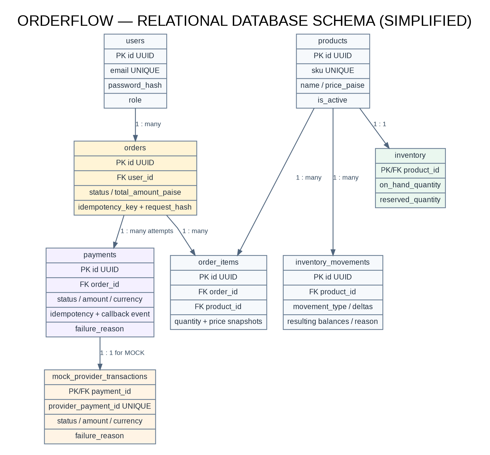
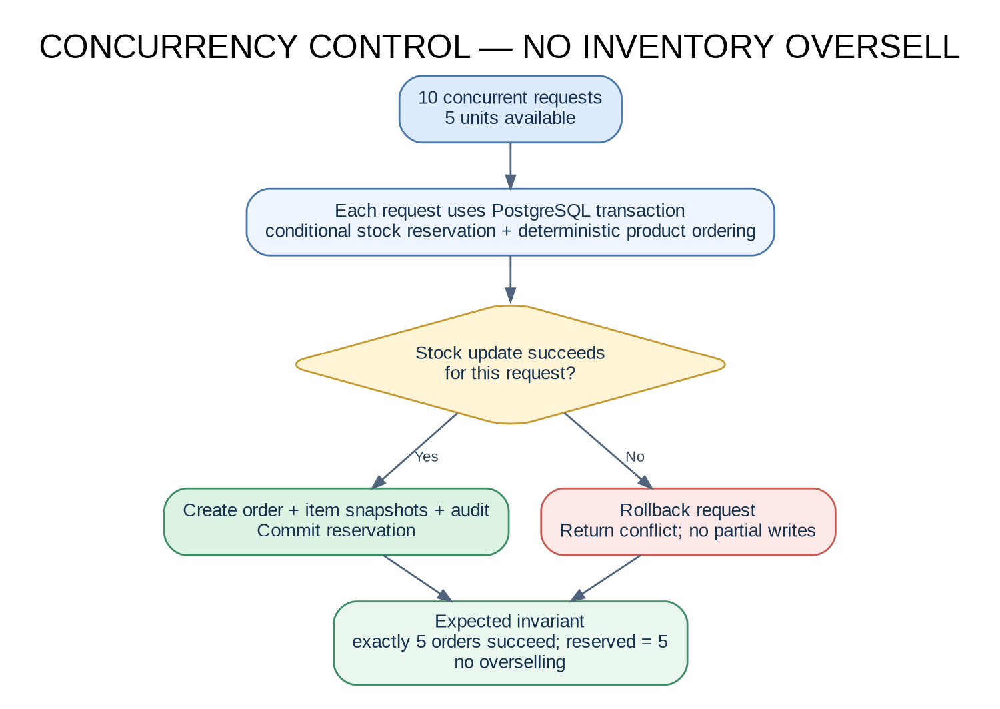
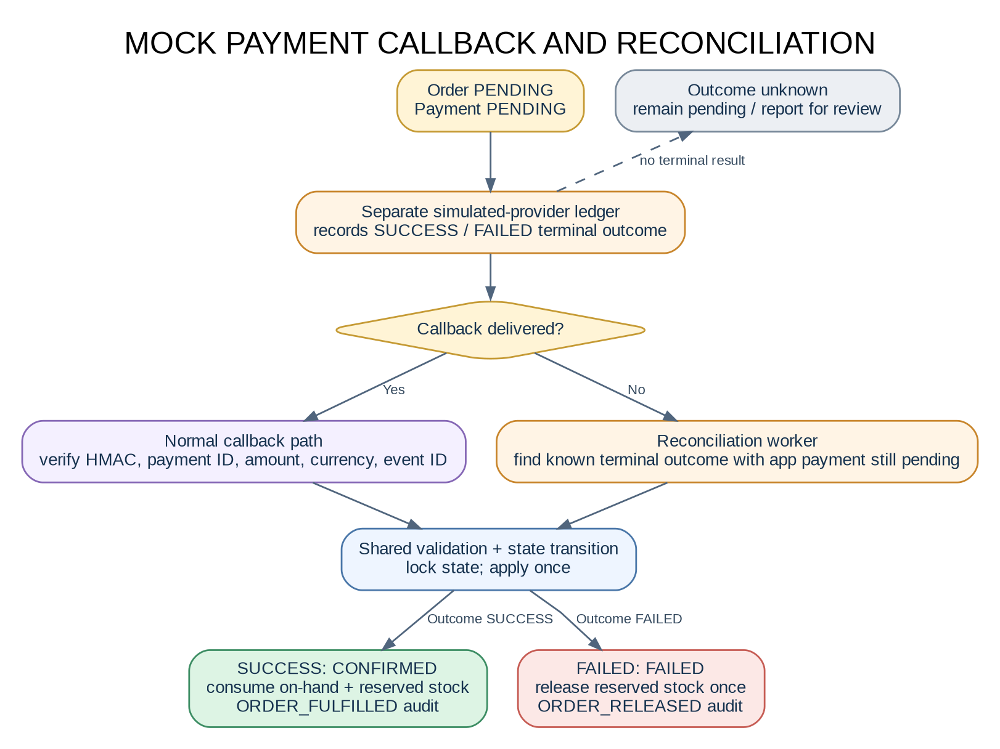
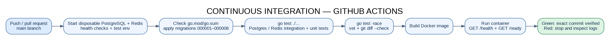
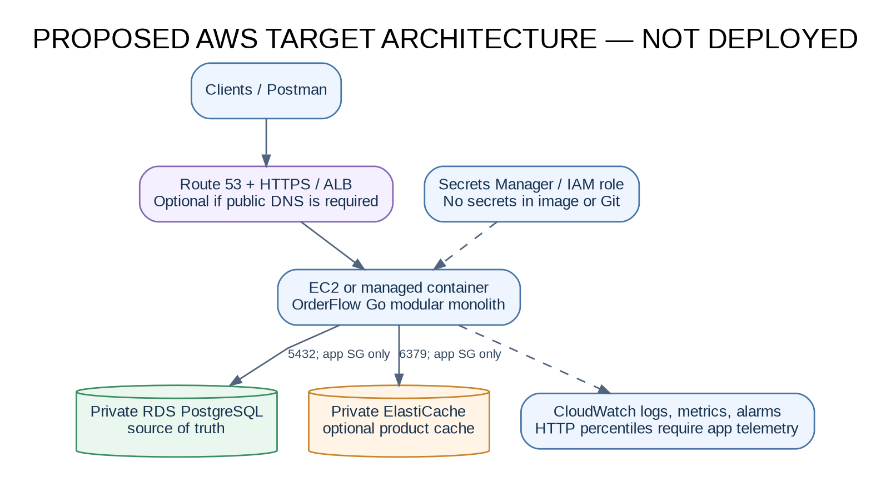

# OrderFlow — E-commerce Order and Payment Management API

**Author:** Manmohan Sharma  
**Repository:** <https://github.com/manmohansharma21/orderflow>  
**Source of truth:** the public `main` branch. Always verify the GitHub Actions run for the exact commit being submitted.  
**Latest CI result:** [GitHub Actions run 39165514715](https://github.com/manmohansharma21/orderflow/actions/runs/39165514715) — completed successfully. The last behavior-changing implementation commit is `1515cb0`; later commits complete benchmark fixes and documentation/evidence.

OrderFlow is a Go/Gin REST backend demonstrating catalogue, inventory, transactional order placement, simulated payment processing, idempotency, recovery of missed simulated-provider callbacks, operational reports and request observability. PostgreSQL is the source of truth. Redis is an optional product-read cache and is **disabled by default** because the tested local workload was slower with the warm cache.

> **Scope clarity:** this is a simulated payment provider, not a real Stripe or money-moving integration. The AWS architecture is documented as a target; no live AWS deployment is claimed. See `docs/AWS_DEPLOYMENT_PLAN.md` before provisioning any chargeable cloud resources.

## Current verified state

The last reviewed baseline had a successful GitHub Actions run; verify the run for the exact commit being submitted. That commit is a documentation/evidence update over the tested Go implementation. CI applies migrations to disposable PostgreSQL, starts Redis, runs unit and integration tests, race checks, `go vet`, whitespace checks, builds the Docker image and probes `/health` and `/ready`. The supplied local logs also show the reliability suite and Docker smoke test passed.

The successful CI workflow is tied to the exact commit above. If code changes after this point, verify the workflow for the new commit before calling that newer revision verified.

## What is implemented

- Customer registration/login with bcrypt password hashing and JWT authentication; admin-only route protection.
- Public product list, search, pagination and detail; admin product create/update/deactivate.
- Inventory availability, stock receipts, adjustments and movement audit history.
- Multi-product order creation (up to 50 distinct product lines), server-side price calculation, transaction-based reservations and immutable order-item snapshots.
- Required order `Idempotency-Key`: identical retries replay the prior order; reusing a key with a different normalized payload returns a conflict.
- Customer-scoped order list/detail/cancellation; conditional inventory updates and transaction rollback.
- Mock payment initiation idempotency; HMAC-SHA256 signed callback verification over raw request bytes; callback amount/currency validation; failure reasons; safe replay handling.
- Successful payment consumes both on-hand and reserved inventory and records `ORDER_FULFILLED`; failed payment releases reservations once.
- Separate simulated-provider transaction ledger and an admin-only demo control to set a provider-side SUCCESS/FAILED outcome without delivering a callback. The reconciliation path can recover such a known outcome through the same validation/state-transition path as the callback.
- Periodic unpaid-order expiry with safe locking; orders with a pending or successful payment are excluded from expiry.
- Admin reports: order totals/status/revenue, date-filtered sales/payment totals, inventory totals and low-stock products.
- Optional Redis cache-aside product list/detail reads with a TTL and generation-based invalidation. Redis errors fail open to PostgreSQL.
- `X-Request-ID`, request logs, and Prometheus text metrics at `/metrics`.
- Health/readiness endpoints, eight numbered SQL migration pairs, Go tests, PostgreSQL integration/concurrency/recovery tests, benchmark scripts, OpenAPI contract, Postman collection, HLD/LLD diagrams and CI configuration.

## Architecture and package layout

### HLD — request and storage architecture

The system is a **modular monolith**: one deployable Go/Gin process contains the HTTP layer, services and background workers. PostgreSQL is the source of truth; Redis is an optional product-read cache, not a separate OrderFlow microservice.


For the editable sources, see `docs/diagrams/HLD.dot` and `docs/diagrams/HLD.mmd`.

### LLD — transactional order creation


The flow shows validation, a transaction-scoped idempotency lock, normalized payload comparison, conditional stock reservation, audit writes, commit, and rollback on conflict.

### Database schema and cardinalities



### Order/payment states


### Concurrency, payment recovery and CI







### Proposed AWS target architecture



All diagrams above are pre-rendered PNGs to display reliably in GitHub. Their editable Graphviz DOT sources are in `docs/diagrams/`; HLD/LLD/order-state Mermaid sources are retained too.

### Package responsibilities

| Package/path | Responsibility |
|---|---|
| `cmd/api/main.go` | Composition root, HTTP server lifecycle, worker start/stop and graceful shutdown |
| `internal/config` | Environment-driven configuration and bounds checking |
| `internal/http` | Gin routes, transport/request DTOs, authentication middleware and HTTP error mapping |
| `internal/domain` | Order, order item, payment, inventory, report and simulated-provider types |
| `internal/service` | Business validation, use-case orchestration, state transitions and cache-aside behavior |
| `internal/repository` | SQL persistence, row locks, conditional inventory changes, idempotency and report queries |
| `internal/database` | PostgreSQL `pgxpool` connection setup |
| `internal/cache` | Redis cache adapter |
| `internal/worker` | Known mock-provider outcome recovery, stale payment reporting and unpaid-order expiry |
| `internal/observability` | Request IDs, bounded-cardinality request metrics/histogram and request logs |
| `internal/integration` | PostgreSQL/Redis integration, concurrency, recovery and benchmark tests |
| `migrations/` | Versioned database schema changes (`000001` through `000008`) |
| `docs/diagrams/` | Editable HLD, LLD and order/payment state diagrams |

Request DTOs currently live next to their relevant HTTP handlers; domain models live in `internal/domain`. A separate DTO package is optional, not a missing correctness requirement. See `docs/DESIGN_PATTERNS.md` and `docs/CI_CONFIGURATION_WALKTHROUGH.md` for learning notes.

## Prerequisites

- Go version compatible with `go.mod` (repository CI uses the version declared in `go.mod`).
- Docker Desktop/Engine with Docker Compose.
- `psql` PostgreSQL client for initial setup/migrations.
- Postman for the API evidence run (optional for basic health checks).

## Local setup — read before running migrations

1. From the repository root, start the dependencies:

   ```bash
   docker compose up -d postgres redis
   docker compose ps
   ```

2. Create a local environment file if you do not already have one:

   ```bash
   cp .env.example .env
   openssl rand -hex 32
   ```

   Generate two different random values. Put one into `JWT_SECRET`, the other into `MOCK_PAYMENT_WEBHOOK_SECRET`. Match the local Postgres port and credentials in `DATABASE_URL`. Do **not** commit `.env` or paste secret values in tickets/screenshots.

3. **Migration safety:** your current `orderflow` and `orderflow_test` databases already have migrations through `000008`. Do not rerun the initial migration loop on these existing databases. For a brand-new empty local database only, apply all `migrations/*.up.sql` in ascending filename order once. The project scripts guard database names and skip applied reliability migrations.

4. Run the application:

   ```bash
   go mod download
   go run ./cmd/api
   ```

5. In another terminal, verify:

   ```bash
   curl -i http://localhost:8080/health
   curl -i http://localhost:8080/ready
   curl -i http://localhost:8080/metrics
   ```

   `/health` should return `200` with `{"status":"ok"}`. `/ready` should return `200` with `{"status":"ready"}` when PostgreSQL is reachable. `/metrics` returns Prometheus text metrics. Each request also carries an `X-Request-ID` response header.

## Main REST APIs

The full OpenAPI 3.0 contract is `docs/openapi.yaml`; import `docs/postman/OrderFlow.postman_collection.json` into Postman.

| Method | Path | Access | Purpose |
|---|---|---|---|
| `GET` | `/health` | Public | Process health |
| `GET` | `/ready` | Public | PostgreSQL readiness |
| `GET` | `/metrics` | Public/internal network recommended | Request counters and latency histogram |
| `POST` | `/auth/register` | Public | Register CUSTOMER |
| `POST` | `/auth/login` | Public | Get JWT |
| `GET` | `/profile` | Bearer JWT | Current user profile/role |
| `GET` | `/products` | Public | Active catalogue search/pagination |
| `GET` | `/products/{id}` | Public | Active product detail |
| `POST` | `/products` | ADMIN | Create product and initial stock |
| `PATCH` | `/products/{id}` | ADMIN | Update product |
| `DELETE` | `/products/{id}` | ADMIN | Deactivate product |
| `GET` | `/inventory/{product_id}` | Public | On-hand, reserved and available quantities |
| `POST` | `/admin/inventory/receipts` | ADMIN | Receive stock with reason |
| `POST` | `/admin/inventory/adjustments` | ADMIN | Adjust stock with reason |
| `GET` | `/admin/inventory/movements` | ADMIN | Paginated stock movement audit |
| `POST` | `/orders` | Bearer JWT + `Idempotency-Key` | Create single-/multi-product order |
| `GET` | `/orders` | Bearer JWT | Current user's orders |
| `GET` | `/orders/{id}` | Bearer JWT | Owner-scoped order detail |
| `POST` | `/orders/{id}/cancel` | Bearer JWT | Cancel pending order |
| `POST` | `/orders/{id}/payments` | Bearer JWT + `Idempotency-Key` | Create/get mock payment attempt |
| `POST` | `/payments/mock-callback` | HMAC-signed request | Deliver simulated provider callback |
| `GET` | `/admin/payments/reconciliation` | ADMIN | Report stale/inconsistent payment states |
| `POST` | `/admin/mock-provider/payments/{id}/outcome` | ADMIN; disabled when `APP_ENV=production` | Demo-only: settle provider ledger without callback |
| `POST` | `/admin/payments/reconciliation/run` | ADMIN | Recover known simulated-provider outcomes now |
| `GET` | `/admin/reports/orders` | ADMIN | Status and confirmed-revenue summary |
| `GET` | `/admin/reports/sales?from=YYYY-MM-DD&to=YYYY-MM-DD` | ADMIN | Date-filtered sales/payment summary |
| `GET` | `/admin/reports/inventory?low_stock_threshold=5` | ADMIN | Inventory/low-stock report |

For the missed-callback demonstration, use only disposable local test data: the collection has a folder named **Missed callback reconciliation demo**. It sets a terminal result in the separate mock-provider ledger, deliberately omits the callback, then invokes the reconciliation endpoint. This is a teaching simulator—not an actual payment gateway.

## Test and static-analysis commands

For ordinary tests:

```bash
go test ./...
go vet ./...
git diff --check
```

For PostgreSQL integration/race tests, keep `ORDERFLOW_TEST_DATABASE_URL` set to the dedicated database named exactly `orderflow_test` in the same terminal. Never point it at `orderflow` or production.

The main local verification script is:

```bash
chmod +x scripts/*.sh
./scripts/verify-residual-milestone.sh
./scripts/docker-smoke-test.sh
```

The first script starts local dependencies as needed, verifies/migrates the designated local/test databases only when migrations are missing, then runs the full Go tests, race-enabled integration tests, vet and whitespace checks. The Docker smoke script builds the image and checks `/health` and `/ready` inside the container. Do not interrupt these commands mid-run; run benchmarking scripts separately rather than chaining them.

### Performance benchmarks — current honest result

The committed run `docs/evidence/performance/benchmark-results-20261018T191309Z.txt` measured 300 product-list API requests per variant with 10 concurrent workers on an Apple M2, macOS arm64, Go 1.27.2, Docker Desktop 29.8.2:

| Metric | Redis disabled | Warm Redis cache |
|---|---:|---:|
| Successful responses | 300/300 | 300/300 |
| P50 latency | 2.480 ms | 4.447 ms |
| P95 latency | 4.270 ms | 13.966 ms |
| Mean latency | 3.315 ms | 5.702 ms |
| Throughput | 2,821.81 req/s | 1,697.92 req/s |

For this small local dataset/workload, Redis was slower. This is a valid negative experiment; the report must not claim a cache speedup. `REDIS_ENABLED=false` is therefore the local default while the cache remains available for evaluation with a representative, larger dataset.

The service/repository-path order benchmarks are different from HTTP P95 measurements. The earlier run was interrupted before `BenchmarkOrderHistoryList` completed, so the order-history number is **not yet a final result**. Run the benchmarks separately and with a bounded duration:

```bash
# Current shell must have ORDERFLOW_TEST_DATABASE_URL set to orderflow_test.
go test -run='^$' -bench='BenchmarkOrderHistoryList' -benchtime=100ms -benchmem -count=1 ./internal/integration/...
```

For the complete product-list HTTP P50/P95 comparison, run the standalone API benchmark, wait for its exit, and keep its output:

```bash
./scripts/benchmark-api-cache.sh
```

Do not run the order-flow benchmark and API benchmark as one long chained command; each writes its own timestamped file under `docs/evidence/performance/`.

## Docker and CI

`Dockerfile` is a multi-stage build. The GitHub Actions workflow (`.github/workflows/ci.yml`) runs on pushes and pull requests to `main`, starts temporary PostgreSQL and Redis service containers, checks module tidiness, applies migrations, runs tests/race/vet, checks whitespace, builds the image and smoke-tests `/health` and `/ready` inside a container.

- The latest implementation and docs are on `main`. Check <https://github.com/manmohansharma21/orderflow/actions> for the run associated with the exact commit you intend to submit.

**CI means Continuous Integration.** It is an automated quality gate that repeats validation consistently when code changes. Learn the job step-by-step in `docs/CI_CONFIGURATION_WALKTHROUGH.md`; the tracker intentionally keeps this walkthrough as a learning task.

## HLD, LLD and design documentation

Editable diagrams:
- `docs/diagrams/HLD.mmd`
- `docs/diagrams/LLD.mmd`
- `docs/diagrams/ORDER_PAYMENT_STATE.mmd`

The README references pre-rendered PNG diagrams to avoid client-side Mermaid parsing/version issues. Editable DOT and Mermaid sources remain available under `docs/diagrams/`. `docs/openapi.yaml`, `docs/OPENAPI_GUIDE.md`, `docs/DESIGN_PATTERNS.md` and `docs/REDIS_AND_RECONCILIATION.md` provide related detail. Keep diagrams and API contracts synchronized if endpoints or transitions change.

## Screenshots and report: final-stage procedure

**Do this only after code is verified, the exact HEAD has green CI, the Postman flow is run, and benchmarks needed for the report are completed.** Save real PNG screenshots into the repository using the exact paths in `docs/evidence/README.md`. Use a demo dataset and keep tokens, passwords, signatures, account IDs and environment values off-screen.

On macOS, press **Command + Shift + 4**, drag to select the evidence region, and save the PNG into the named `docs/evidence/...` folder. Prefer a useful window crop showing request/command and successful result over a full desktop capture. In Postman, keep the request name, method/path, status and response JSON visible, but do not expose the Authorization tab/token or webhook secret. Use markup to permanently redact any accidental sensitive text before committing the PNG. For the CI evidence use the green completed run for the exact submitted SHA. For AWS, capture only if an actual approved deployment was performed and the evaluation requires it.

The final evidence session is described in `docs/SCREENSHOT_CHECKLIST.md` and `docs/evidence/README.md`; the same PNGs must be inserted into the corresponding figure placeholders in the Word report before exporting the submission PDF.

## Release verification

Before producing a release archive, run `go test ./...`, `go test -race ./internal/integration/...`, `go vet ./...`, and `git diff --check`; verify the GitHub Actions run for the exact commit. Keep generated evidence and editable diagrams in the repository, and never commit `.env`, credentials or database backups. Personal portal-upload steps are maintained separately in `docs/FINAL_SUBMISSION_STATUS.md`.

## Scope boundaries and limitations

- No real Stripe/money-moving gateway is implemented; simulated provider callbacks and recovery are used as the capstone test mechanism.
- Redis did not speed up the measured small local workload; further performance claims require new measurement.
- AWS infrastructure is documented, not deployed. Only claim live AWS after creating resources with approval and verifying the live endpoint. Whether a live AWS deployment is mandatory must be confirmed against any separate assignment/contest rubric; the supplied submission screen itself requests a repo link, project ZIP, report PDF and declarations, not an AWS URL.
- Screenshots and final report PDF are a last-mile evidence task. This source README is the operating guide; the Word report is maintained separately from the code ZIP.


## Screenshot evidence status (19 October 2026)

Genuine local evidence already committed under `docs/evidence/` includes a combined HTTP 200 health/readiness terminal capture, the `/metrics` exposition, and an initial development log showing `POST /orders` returning 201. The early migration-only capture and readiness-only duplicate are kept in `initial-captures/` and are not evidence of the final schema. A screenshot that exposed a local `DATABASE_URL` password was deliberately excluded.

The final Postman screenshots still need to be taken from actual passing requests: auth/401/403, product admin/409, inventory audit, multi-product order/idempotency/cancellation, payment callback and missed-callback recovery/reports. Also capture a green Actions run for the final evidence commit and a fresh Docker smoke test. Follow `docs/evidence/README.md` and `docs/evidence/POSTMAN_SCREENSHOT_RUNBOOK.md`; do not include tokens, passwords or webhook signatures.


## Additional benchmark evidence

The run captured at `docs/evidence/performance/benchmark-results-20261018T230232Z.png` showed 300/300 successful requests in both variants. This run favored warm Redis (P50 2.429 ms vs 2.829 ms; P95 4.140 ms vs 5.203 ms), while an earlier run showed the opposite. Treat results as variable local measurements, not a guaranteed cache speedup. See `docs/evidence/performance/README.md`.
