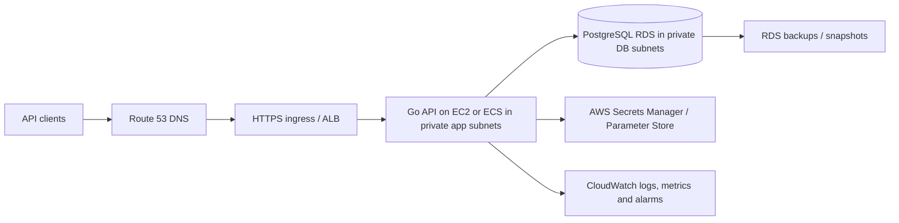

# AWS deployment plan (target design — not yet deployed)

This is a proposed deployment path for the existing Go API. It is not evidence that AWS infrastructure has been created or tested, and the steps can incur AWS charges. Use a sandbox account and review costs before provisioning.

## Target high-level design

## Deployment choices

- **Lowest-friction coursework option:** one EC2 instance for the API behind a security group, managed PostgreSQL RDS in private subnets, Route 53 + ACM/ALB if a domain and HTTPS are required.
- **More production-like option:** ECS Fargate service in private app subnets behind an Application Load Balancer; RDS in private DB subnets. Prefer this if container orchestration is part of the rubric.
- **Do not publicly expose PostgreSQL.** Allow port 5432 only from the application security group.

## Implementation checklist

1. Pick a region and budget guardrail; enable billing alerts before creating resources.
2. Create a VPC with public ingress subnets and private application/database subnets across at least two AZs where the assignment permits.
3. Create an RDS PostgreSQL instance in private subnets; require strong credentials and TLS; enable backups and set retention.
4. Build the app image using the repository Dockerfile and push it to ECR (if using ECS) or deploy the binary/container on EC2.
5. Put `DATABASE_URL`, `JWT_SECRET`, and `MOCK_PAYMENT_WEBHOOK_SECRET` in Secrets Manager/Parameter Store. Never bake secrets into an image or commit them.
6. Apply the six SQL migrations to the intended empty/compatible target database using a controlled migration job and backup first. Do not run integration migration scripts against RDS production data.
7. Configure security groups: HTTPS only from intended clients to the load balancer; app port reachable only from the load balancer; PostgreSQL only from app security group.
8. Configure HTTPS certificate/Route 53 record if using a custom domain. Add `/health` and `/ready` health checks with sensible timeout and thresholds.
9. Ship structured logs and basic metrics; create alarms for 5xx rate, unhealthy tasks/instances, CPU/memory, database connections/storage and failed readiness.
10. Run smoke tests and a rollback/backup test. Capture only redacted screenshots.

## Required evidence to call deployment complete

- Architecture diagram with actual provisioned service names/regions, keeping secrets private.
- Successful deploy pipeline or documented deployment command.
- `/health` and `/ready` responses from the deployed environment.
- Redacted product/order happy-path verification against the deployed test environment.
- RDS backup configuration and CloudWatch alarm screenshots.
- Teardown/cost-control notes for temporary coursework resources.

## Not included yet

This repository currently has no Terraform/CloudFormation stack, no ECR publish workflow, and no verified AWS endpoint. Those require scope/credentials and a separate tested infrastructure change. Do not report the target diagram as a completed deployment.
