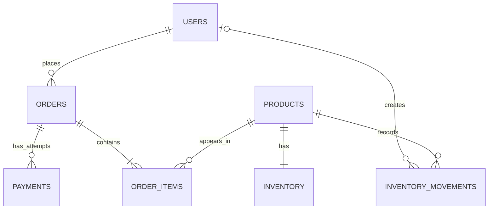

# OrderFlow code-reading guide: DTOs, models, repositories and patterns

This guide documents the code that already exists at remote-review commit `8ffd04e`. It is not proposing a parallel implementation.

## Request DTOs vs domain models

Go does not require every DTO to live in a separate package. Current HTTP request shapes are private handler-level structs:

- `registerRequest`, `loginRequest`, `authClaims` — `internal/http/auth.go`
- `createProductRequest`, `updateProductRequest` — `internal/http/products.go`
- `createOrderRequest` — `internal/http/orders.go`
- `mockPaymentCallbackRequest` — `internal/http/payments.go`
- `receiveStockRequest`, `adjustStockRequest` — `internal/http/inventory.go`

This keeps transport validation close to the HTTP endpoint and avoids leaking request-only fields into business logic. Handler code maps requests into domain/service inputs explicitly. The public response models are in `internal/domain`:

- Product: `internal/domain/product.go`
- Order and order item: `internal/domain/order.go`
- Payment and reconciliation: `internal/domain/payment.go`
- Inventory and movements: `internal/domain/inventory.go`

If the API grows multiple transports (for example REST and message consumers) or a field needs different inbound/outbound semantics, splitting request/response DTOs into a dedicated package could be a justified refactor. It is not needed simply to satisfy a folder-name convention.

## Layering pattern

`internal/http` → `internal/service` → `internal/repository` → `pgxpool` / PostgreSQL.

1. **HTTP handler** binds JSON/query/path values, performs transport validation, calls a service, maps domain errors to HTTP responses, returns JSON.
2. **Service** owns business invariants: trim/normalize inputs, validate amounts and state transitions, set bounds, orchestrate transaction work, and map persistence errors to use-case errors.
3. **Repository** owns SQL and persistence mechanics: joins, conditional updates, row locks, movement inserts, and transaction-level methods.
4. **Domain types** transfer values between layers and describe response contracts.
5. **Composition root** (`cmd/api/main.go`, `internal/http/router.go`) constructs the pool, repositories, services and handlers.

The repository layer uses explicit SQL with `pgx`, not an ORM. That is intentional and allows the implementation to use conditional updates and transaction locks where correctness depends on them.

## Patterns actually present

### Repository pattern

Each repository wraps PostgreSQL operations for a bounded concern: product, order, payment or inventory. Services do not inline SQL; HTTP handlers do not directly manipulate order/inventory tables apart from auth/profile handling.

### Service / use-case layer

`ProductService`, `OrderService`, `PaymentService` and `InventoryService` validate and coordinate use cases. Domain errors are translated by HTTP handlers to statuses such as 400, 404, 409, 401 and 403.

### Unit of Work / transaction boundary

Order creation reserves stock, creates the order/order item and records the inventory movement in one transaction. If a later operation fails, deferred rollback keeps the database from persisting a partial order or a stranded reservation.

### Conditional update for concurrency safety

Inventory reservation is a single `UPDATE ... WHERE on_hand_quantity - reserved_quantity >= requested_quantity RETURNING ...`. PostgreSQL serializes conflicting row updates, preventing inventory oversell without a separate read-then-write race.

### Pessimistic row locking

Payment initiation/callback processing locks the order and then the payment row to serialize state transitions and align lock ordering. Order cancellation locks the order before releasing inventory.

### Idempotency / replay safety

Payment initiation checks `Idempotency-Key`; callback processing records a unique event identifier and safely returns the same terminal outcome on same-outcome replay. Conflicting outcomes or cross-payment key reuse produce a conflict.

### Audit trail

Inventory changes create `inventory_movements` rows with deltas, resulting balances, reason, optional user, and reference fields. The balance table is the current view; the movement table provides traceability.

### Middleware / composition root

Gin middleware validates bearer JWTs and role claims. `router.go` wires routes and dependencies. `main.go` owns server setup and graceful shutdown.

## Main database entities

## Go code that is already present

| Concern | File(s) |
|---|---|
| HTTP endpoints and validation | `internal/http/*.go` |
| Domain models / response shapes | `internal/domain/*.go` |
| Business rules / orchestration | `internal/service/*.go` |
| SQL repositories | `internal/repository/*.go` |
| Config and database pool | `internal/config/config.go`, `internal/database/postgres.go` |
| Migrations | `migrations/*.up.sql`, `migrations/*.down.sql` |
| Unit tests | `internal/http/*_test.go`, `internal/service/*_test.go` |
| PostgreSQL integration tests | `internal/integration/*_test.go` |

## Deliberate limitations / design discussion points

- `HTTP request DTOs` are private structs beside handlers rather than in an `internal/dto` package. Do not add unused duplicate structs.
- Persistence is explicit SQL/`pgx`; JPA/Hibernate annotations and Spring `ResponseEntity` do not apply to this Go stack. Their comparable responsibilities are handled by request binding, services, repositories and `c.JSON`/HTTP status mapping.
- The payment provider is MOCK; the HMAC signature format is project-specific.
- The residual implementation bundle adds optional Redis cache-aside behavior for product reads with TTL and generation invalidation.
- A configurable read-only reconciliation worker periodically reports issues from the existing reconciliation service; it does not modify payment status.

## Additional patterns added in the residual milestone

- **Cache-aside (best effort):** the ProductService checks Redis, falls back to PostgreSQL on a miss/error, and caches successful reads with a TTL. PostgreSQL remains authoritative.
- **Generation-based invalidation:** product mutations increment one Redis generation value instead of scanning keys. New requests use the new namespace immediately; old keys expire by TTL.
- **Ticker worker / graceful cancellation:** a background worker periodically invokes the read-only reconciliation report and logs the results. Set `RECONCILIATION_INTERVAL_SECONDS=0` to disable it.
