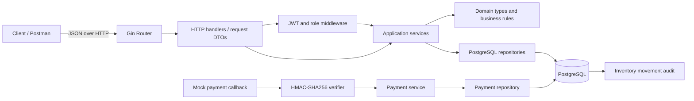
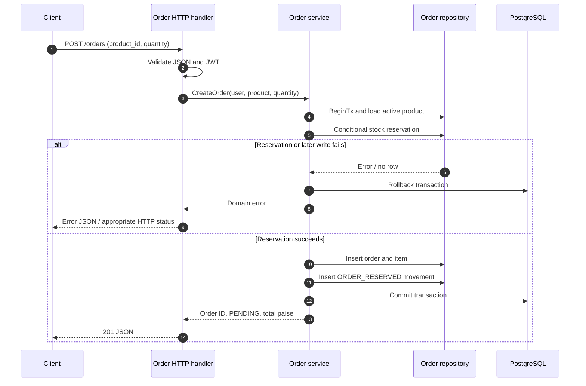
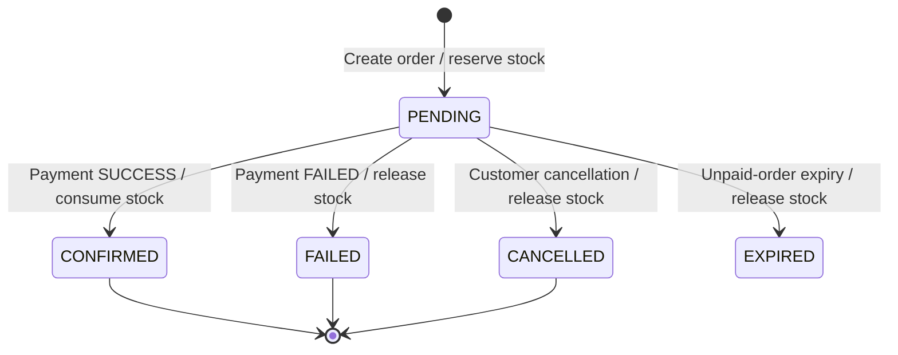

# OrderFlow Backend Project Report

**Technology:** Go 1.26, Gin, PostgreSQL, `pgx`, JWT, bcrypt, SQL migrations
**Repository:** `https://github.com/manmohansharma21/orderflow`
**Report scope:** OrderFlow implementation in the current repository, including reliability migration `000007`, multi-product/idempotent order creation, inventory/payment transitions, Redis catalog cache, admin reports, Docker and CI. Replace the final commit SHA with the exact submitted SHA after the last verification run.

## 1. Abstract

OrderFlow is a backend API demonstrating core e-commerce flows: user registration/authentication, product administration, inventory management, transactional order creation, mock payments and payment/order reconciliation. The system is layered into HTTP handlers, services, repositories and domain types. PostgreSQL provides durable storage, transactions, conditional stock reservation and row-level locking. Inventory movements are recorded for auditability, and payment initiation/callback processing is designed to tolerate duplicate requests.

The integration tests exercise order/payment workflows, rollback behavior, concurrent requests, Redis TTL/invalidation, and periodic worker behavior against disposable dependencies. The provider is simulated, not Stripe. AWS resources are not represented as deployed unless provisioned and verified separately.

## 2. Problem statement and goals

The application needs to coordinate orders, stock and payment state without overselling available inventory or persisting partial writes. Its goals are to expose a clear REST API, enforce customer/admin access, represent money without floating-point error, trace inventory changes, make payment retries safe, and provide testable deployment/operational entry points.

## 3. Scope and principal features

- Register/login customers using bcrypt hashes and HS256 JWT access tokens.
- Admin CRUD for products, including deactivation instead of hard deletion.
- Public search/pagination of active products and inventory availability.
- Authenticated create/list/read/cancel order flows, scoped to the owning user.
- Transactional stock reservation; reject insufficient stock without a partial order.
- Admin stock receipt/adjustment with reason and movement-history records.
- Mock payment initiation using idempotency keys and signed callback handling.
- Admin payment reconciliation for selected inconsistent/stale states.
- Health/readiness probes, SQL migrations, unit tests and PostgreSQL-backed integration tests.

## 4. High-level architecture (HLD)



This diagram describes the current application layers. An AWS target architecture, if required, should put the API in a private application network behind a load balancer, keep RDS private, store secrets in Secrets Manager/Parameter Store, and add CloudWatch alarms. None of those AWS resources are claimed to be deployed by this repository snapshot.

## 5. Low-level design (LLD)



### Order/payment state model



## 6. Layer responsibilities and patterns

- **HTTP/DTO layer:** binds JSON, path and query inputs, validates transport shape, invokes services, maps errors to HTTP status codes.
- **Domain models:** represent products, orders/items, payments, reconciliation issues and inventory movements.
- **Service layer:** validates business invariants, coordinates transactions and controls permitted state transitions.
- **Repository layer:** encapsulates PostgreSQL SQL, conditional updates, row locks, joins and persistence mappings.
- **Database schema:** separates master/current state (products, inventory, orders, payments) from stock movement history.
- **Repository pattern:** persistence concerns are isolated by product/order/payment/inventory repositories.
- **Unit of Work:** the order creation flow groups stock reservation, order, line item and movement insertion in a single transaction.
- **Idempotency:** payment creation accepts `Idempotency-Key`; callbacks use an event ID and safe same-outcome replay behavior.
- **Audit trail:** inventory movement rows document stock delta, resulting stock, reason, actor and reference.

In this codebase, transport DTO structs are private to their HTTP handlers; domain structs live in `internal/domain`. A separate DTO package is an optional future refactor, not a missing requirement.

## 7. API overview

The complete contract is maintained in `docs/openapi.yaml`. The main resource groups are:

- **Authentication:** `/auth/register`, `/auth/login`, `/profile`.
- **Products:** `/products`, `/products/{id}`.
- **Inventory:** `/inventory/{product_id}`, `/admin/inventory/receipts`, `/admin/inventory/adjustments`, `/admin/inventory/movements`.
- **Orders:** `/orders`, `/orders/{id}`, `/orders/{id}/cancel`.
- **Payments:** `/orders/{id}/payments`, `/payments/mock-callback`, `/admin/payments/reconciliation`.
- **Operations:** `/health`, `/ready`.

## 8. Data and correctness considerations

Money is stored as integer paise. The database constrains prices/amounts and inventory quantities to nonnegative values and requires reserved stock not to exceed on-hand stock. Order stock reservation uses a conditional database update rather than an application-level read-then-write. Transactions roll back if subsequent order/item/audit writes fail. Payment/cancellation paths lock relevant order state to reduce conflicting transitions. Historical order item values preserve item name/price at the time of order, rather than depending on future product edits.

## 9. Verification evidence

Commit `d891056` has a successful GitHub Actions run including the migration chain, unit/database/Redis tests, integration race tests, vet, Docker build and runtime health/readiness probes. Any additional final-review patch must receive a new green run before it is described as verified.

Prior owner-run test commands were:

```text
go test ./...
go test -race -count=1 ./internal/integration/...
go vet ./...
git diff --check
```

The PostgreSQL integration suite covers order stock reservation/audit movements, insufficient stock without a partial order, payment success (including inventory consumption), payment failure with one-time stock release, same-key order/payment idempotency, concurrent reservations, concurrent payment initiation, concurrent callback replay, expiry rollback/state, and transaction rollback. The suite and reliability changes must pass against the actual developer and CI databases before the report is marked final. Keep real terminal screenshots and the matching green CI URL in the submission evidence folder at the final evidence session.

## 10. Security considerations

- Passwords are bcrypt-hashed, not stored in plaintext.
- Protected routes require bearer JWTs; admin routes check the role claim.
- JWT and callback secrets must be independently generated and kept out of Git.
- The mock callback signs exact raw-body bytes using HMAC-SHA256 and uses constant-time MAC comparison.
- PostgreSQL integration tests are guarded to the exact database name `orderflow_test` and create uniquely named fixtures.
- For production, add TLS ingress, managed secrets, rate limiting, log redaction, key rotation, and more restrictive database/network controls before exposure.

## 11. Limitations and further work

1. **Redis:** product list/detail cache with TTL and generation-based invalidation is implemented. The latest measured small local API workload was slower with the warm Redis cache, so Redis is disabled by default pending a representative benchmark that demonstrates benefit.
2. **Payment gateway:** provider remains a mock; production Stripe/other provider integration, provider-native signature verification, retries and provider reconciliation require separate implementation and credentials.
3. **Scheduled reconciliation:** configurable read-only worker periodically emits the existing report to logs. It does not automatically change orders or payments. Confirm whether the rubric expects a cron/worker or only reconciliation logic.
4. **Cloud deployment:** no AWS resources have been provisioned or evidenced. The AWS deployment guide is a plan, not proof of deployment.
5. **Operational evidence:** Postman execution screenshots and actual run URLs still need to be collected.
6. **Docker:** CI is configured to build and run health/readiness probes against the image; capture its successful run after this milestone is pushed.

## 12. Conclusion

OrderFlow implements the core product, inventory, multi-product order, idempotency, mock-payment, cancellation, expiry and reporting workflows with PostgreSQL-backed correctness controls. The local provider-recovery demo and HTTP observability additions must pass the final local test suite and a CI run on the submitted SHA. Live Stripe is outside the initial simulated-provider scope; AWS deployment depends on the evaluation rubric and actual resource approval.


## Reliability features added in the final code overlay (verification required)

Order creation accepts either one legacy item or a multi-product `items` array. The server resolves all prices, sorts inventory locks, reserves each product, creates immutable order-item snapshots and records movement rows in a single PostgreSQL transaction. The HTTP API requires a per-request `Idempotency-Key`; repeated identical requests return the original order, while a key reused with a changed payload returns a conflict.

Payment callbacks sent to the HTTP API include amount and currency. The callback handler verifies the HMAC over the raw body and compares amount/currency to the persisted payment before mutating state. A failure reason is stored on failed payments. A successful callback atomically confirms the order, decreases on-hand and reserved quantities, and records `ORDER_FULFILLED`; callback replay does not consume inventory twice.

A periodic expiry worker releases reservations only for old PENDING orders with no PENDING or SUCCESS payment. Orders with unresolved payments are intentionally excluded because a delayed provider notification could indicate a charge already occurred. Scheduled payment reconciliation remains read-only for the mock provider until a provider status-lookup contract exists. Admin reports expose order status totals, date-filtered sales/payment sums and inventory/low-stock totals.

`BenchmarkProductListDatabaseVsRedis` compares PostgreSQL reads to warm Redis hits. In the supplied local API run (300 requests per variant, 10 concurrent workers, Apple M2, Go 1.27.2, Docker 29.8.2), cache disabled produced P50 2.480 ms, P95 4.270 ms, mean 3.315 ms and 2821.81 requests/s; warm Redis produced P50 4.447 ms, P95 13.966 ms, mean 5.702 ms and 1697.92 requests/s. Redis was slower for this workload; no improvement is claimed. The AWS diagram is a target design, not evidence of live deployment.
