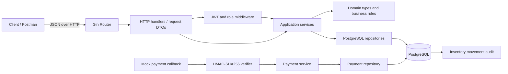
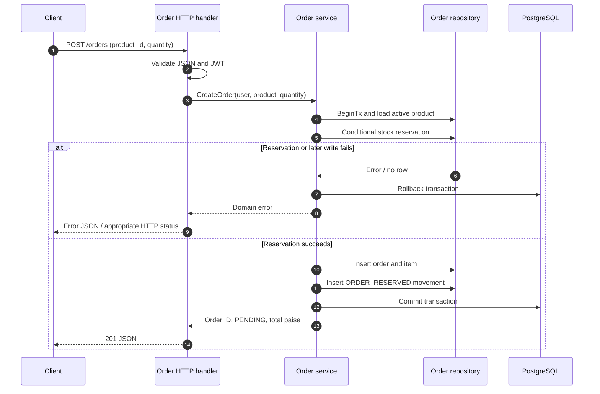
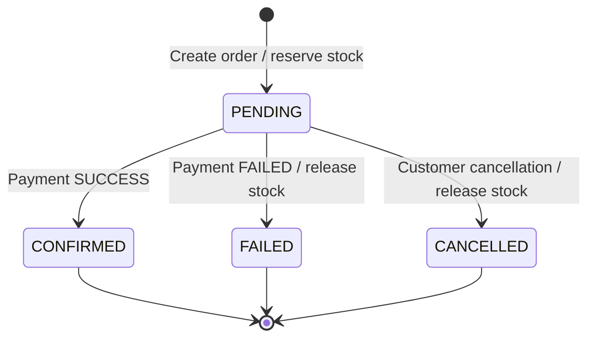

# OrderFlow Backend Project Report

**Technology:** Go 1.26, Gin, PostgreSQL, `pgx`, JWT, bcrypt, SQL migrations  
**Repository:** `https://github.com/manmohansharma21/orderflow`  
**Report scope:** implementation present at remote-review commit `8ffd04e`, plus documentation and CI artifacts proposed in this bundle.

## 1. Abstract

OrderFlow is a backend API demonstrating core e-commerce flows: user registration/authentication, product administration, inventory management, transactional order creation, mock payments and payment/order reconciliation. The system is layered into HTTP handlers, services, repositories and domain types. PostgreSQL provides durable storage, transactions, conditional stock reservation and row-level locking. Inventory movements are recorded for auditability, and payment initiation/callback processing is designed to tolerate duplicate requests.

The current integration tests exercise core order/payment flows, rollback behavior and concurrent requests against a dedicated PostgreSQL test database. Live Stripe processing, Redis caching and cloud deployment are future work and are not represented as completed features in this report.

## 2. Problem statement and goals

The application needs to coordinate orders, stock and payment state without overselling available inventory or persisting partial writes. Its goals are to expose a clear REST API, enforce customer/admin access, represent money without floating-point error, trace inventory changes, make payment retries safe, and provide testable deployment/operational entry points.

## 3. Scope and principal features

- Register/login customers using bcrypt hashes and HS256 JWT access tokens.
- Admin CRUD for products, including deactivation instead of hard deletion.
- Public search/pagination of active products and inventory availability.
- Authenticated create/list/read/cancel order flows, scoped to the owning user.
- Transactional stock reservation; reject insufficient stock without a partial order.
- Admin stock receipt/adjustment with reason and movement-history records.
- Mock payment initiation using idempotency keys and signed callback handling.
- Admin payment reconciliation for selected inconsistent/stale states.
- Health/readiness probes, SQL migrations, unit tests and PostgreSQL-backed integration tests.

## 4. High-level architecture (HLD)



This diagram describes the current application layers. An AWS target architecture, if required, should put the API in a private application network behind a load balancer, keep RDS private, store secrets in Secrets Manager/Parameter Store, and add CloudWatch alarms. None of those AWS resources are claimed to be deployed by this repository snapshot.

## 5. Low-level design (LLD)



### Order/payment state model



## 6. Layer responsibilities and patterns

- **HTTP/DTO layer:** binds JSON, path and query inputs, validates transport shape, invokes services, maps errors to HTTP status codes.
- **Domain models:** represent products, orders/items, payments, reconciliation issues and inventory movements.
- **Service layer:** validates business invariants, coordinates transactions and controls permitted state transitions.
- **Repository layer:** encapsulates PostgreSQL SQL, conditional updates, row locks, joins and persistence mappings.
- **Database schema:** separates master/current state (products, inventory, orders, payments) from stock movement history.
- **Repository pattern:** persistence concerns are isolated by product/order/payment/inventory repositories.
- **Unit of Work:** the order creation flow groups stock reservation, order, line item and movement insertion in a single transaction.
- **Idempotency:** payment creation accepts `Idempotency-Key`; callbacks use an event ID and safe same-outcome replay behavior.
- **Audit trail:** inventory movement rows document stock delta, resulting stock, reason, actor and reference.

In this codebase, transport DTO structs are private to their HTTP handlers; domain structs live in `internal/domain`. A separate DTO package is an optional future refactor, not a missing requirement.

## 7. API overview

The complete contract is maintained in `docs/openapi.yaml`. The main resource groups are:

- **Authentication:** `/auth/register`, `/auth/login`, `/profile`.
- **Products:** `/products`, `/products/{id}`.
- **Inventory:** `/inventory/{product_id}`, `/admin/inventory/receipts`, `/admin/inventory/adjustments`, `/admin/inventory/movements`.
- **Orders:** `/orders`, `/orders/{id}`, `/orders/{id}/cancel`.
- **Payments:** `/orders/{id}/payments`, `/payments/mock-callback`, `/admin/payments/reconciliation`.
- **Operations:** `/health`, `/ready`.

## 8. Data and correctness considerations

Money is stored as integer paise. The database constrains prices/amounts and inventory quantities to nonnegative values and requires reserved stock not to exceed on-hand stock. Order stock reservation uses a conditional database update rather than an application-level read-then-write. Transactions roll back if subsequent order/item/audit writes fail. Payment/cancellation paths lock relevant order state to reduce conflicting transitions. Historical order item values preserve item name/price at the time of order, rather than depending on future product edits.

## 9. Verification evidence

At baseline commit `8ffd04e`, the project owner ran and reported successful outputs for:

```text
go test ./...
go test -race -count=1 ./internal/integration/...
go vet ./...
git diff --check
```

The PostgreSQL integration suite covers order stock reservation/audit movements, insufficient stock without a partial order, payment success, payment failure with one-time stock release, same-key idempotency, concurrent reservations, concurrent payment initiation, concurrent callback replay, and transaction rollback. Keep final terminal screenshots or CI run URLs in the submission evidence folder when available. The docs/CI bundle in the next commit should itself be validated before claiming its workflow passed.

## 10. Security considerations

- Passwords are bcrypt-hashed, not stored in plaintext.
- Protected routes require bearer JWTs; admin routes check the role claim.
- JWT and callback secrets must be independently generated and kept out of Git.
- The mock callback signs exact raw-body bytes using HMAC-SHA256 and uses constant-time MAC comparison.
- PostgreSQL integration tests are guarded to the exact database name `orderflow_test` and create uniquely named fixtures.
- For production, add TLS ingress, managed secrets, rate limiting, log redaction, key rotation, and more restrictive database/network controls before exposure.

## 11. Limitations and further work

1. **Redis:** no cache layer or TTL/invalidation is implemented at baseline.
2. **Payment gateway:** provider is a mock; production Stripe/other provider integration, signature verification, retries and provider reconciliation need separate implementation and credentials.
3. **Reconciliation scheduling:** report endpoint is on-demand; no scheduled worker/cron is implemented.
4. **Cloud deployment:** no AWS resources have been provisioned or evidenced. An AWS deployment guide is provided separately as a plan, not proof of deployment.
5. **Operational evidence:** Postman execution screenshots and real CI run screenshots remain to be collected.
6. **Coverage improvement:** database/config/repository paths may have limited direct unit coverage; integration coverage currently provides the main database correctness confidence.

## 12. Conclusion

OrderFlow implements the central backend path from product and inventory through transactional order creation and mock payment state changes, with a layered Go design and PostgreSQL-backed correctness controls. The next steps are to validate the added OpenAPI/CI/container/documentation files, capture submission evidence, and decide from the rubric whether Redis, live payment processing, scheduled reconciliation and AWS deployment must be completed before submission.
