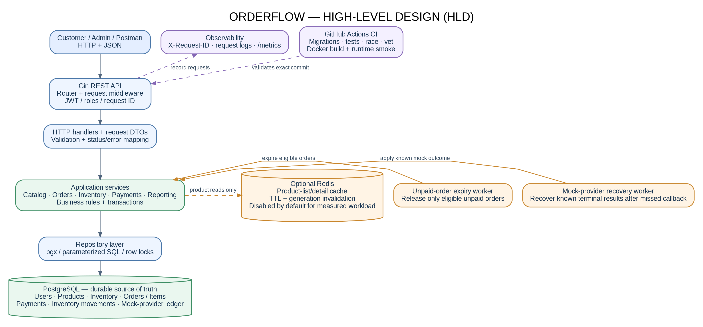
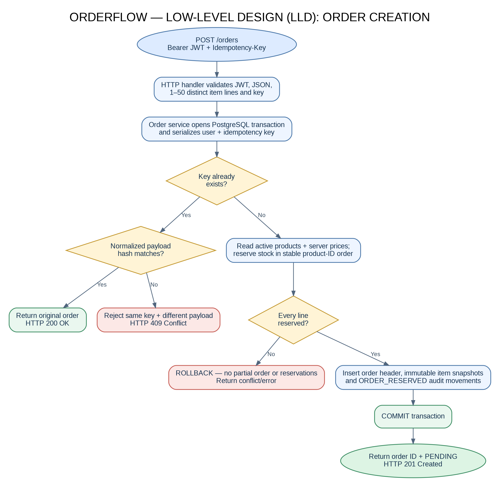
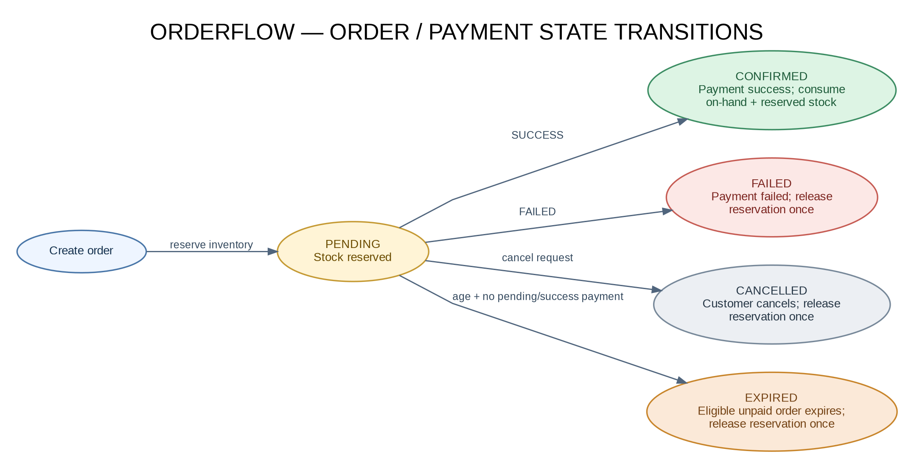

# OrderFlow — applied software project report source

**Candidate:** Manmohan Sharma
**Programme:** Master of Science in Computer Science, Scaler Neovarsity - Woolf
**Supervisor shown in template:** Naman Bhalla
**Repository:** https://github.com/manmohansharma21/orderflow
**Last verified code baseline:** `3df0139`
**GitHub Actions:** https://github.com/manmohansharma21/orderflow/actions/runs/39163364836 (success)
**Evidence/doc revision:** pending a new green CI run after the diagram and screenshot patch is pushed.

This Markdown file is the technical content source for the separate Word report. Use the supplied Word review draft as the submission layout; it follows the official report template structure, includes HLD/LLD/state diagrams and screenshot placeholders, and must be completed and exported to PDF after the final evidence session. Do not submit this Markdown file instead of the PDF required by the portal.

## Abstract

OrderFlow is a Go/Gin REST backend demonstrating catalogue administration, inventory management, multi-product order creation, transactional stock reservation, simulated payment processing and recovery, and operational reporting. PostgreSQL is the durable source of truth; `pgx` provides database access. Authentication uses password hashing and JWTs with role-based authorization. The order path calculates prices server-side, checks stock and writes order-item snapshots plus inventory movements in a database transaction. Order and payment initiation idempotency, callback validation and locking protect against duplicate requests, duplicate callbacks and concurrency conflicts.

The application includes a mock-provider ledger that can record a terminal provider result independently of callback delivery. Reconciliation recovers known simulated outcomes through the same validated payment state-transition path. An unpaid-order worker expires eligible old orders only when no pending/successful payment is recorded. Redis product caching is optional; the supplied local API benchmark showed worse latency and throughput with warm Redis than with cache disabled, so this report records the negative result and makes no claim of a speedup. The exact submitted source revision passed GitHub Actions tests, race checks, static analysis, migrations and Docker smoke validation. The project does not claim live Stripe integration or an actual AWS deployment.

## Purpose and requirement coverage

The business goal is to show a reliable backend flow from catalogue and inventory through order creation and payment outcome, not only CRUD. Important invariants are: server-side pricing; available stock equals on-hand minus reserved; reservation plus order writes are atomic; user orders are owner-scoped; repeated identical idempotency keys do not create duplicates; callback amount/currency must match; SUCCESS consumes stock exactly once; FAILED/cancelled/expired orders release reservations exactly once; and unresolved payments are not expired blindly.

## Architecture

The application is a modular monolith. The HTTP layer validates transport shapes and maps errors; services apply business rules and coordinate transitions; repositories perform parameterized SQL and locking; PostgreSQL keeps source-of-truth state. `internal/cache` contains the Redis adapter; `internal/worker` contains provider recovery/reporting and unpaid-order expiry; `internal/observability` provides request IDs and an HTTP latency histogram.

### High-level design (HLD)

### Low-level design (LLD)

### Order/payment state transitions

Editable Graphviz sources are `docs/diagrams/HLD.dot`, `LLD.dot`, and `ORDER_PAYMENT_STATE.dot`; simpler Mermaid source equivalents are kept beside them. The report uses the static PNG renderings to avoid browser rendering errors. The database includes users, products, inventory, inventory movements, orders, order items, payments and the mock-provider transaction ledger. Migrations are ordered `000001`–`000008`.

## Main endpoint groups

- Authentication: `POST /auth/register`, `POST /auth/login`, `GET /profile`.
- Products: `GET /products`, `GET /products/{id}`, and ADMIN-only `POST`, `PATCH`, `DELETE` operations.
- Inventory: `GET /inventory/{product_id}` and ADMIN-only receipt, adjustment and movement history routes.
- Orders: `POST /orders` with required `Idempotency-Key`, plus user-scoped `GET /orders`, `GET /orders/{id}`, `POST /orders/{id}/cancel`.
- Payments: `POST /orders/{id}/payments`; signed `POST /payments/mock-callback`; ADMIN payment reconciliation/report endpoints.
- Mock-provider recovery demo: ADMIN-only `POST /admin/mock-provider/payments/{id}/outcome` (not available under `APP_ENV=production`) and `POST /admin/payments/reconciliation/run`.
- Reports: ADMIN-only `GET /admin/reports/orders`, `/admin/reports/sales`, `/admin/reports/inventory`.
- Operations: `GET /health`, `/ready`, `/metrics`.

The OpenAPI contract is `docs/openapi.yaml`; Postman collection is `docs/postman/OrderFlow.postman_collection.json`.

## Correctness and recovery

Order creation takes either the legacy single-product payload or an `items` array of 1–50 distinct product lines. It uses a stable product lock order, server-read prices and a normalized request hash. Same-key identical requests return the existing order; reusing the key with a different payload conflicts. Stock reservations and order/item/audit writes share a PostgreSQL transaction.

The mock payment callback validates its HMAC over exact raw-body bytes, validates amount and currency against stored payment terms, and records a failure reason for a failed outcome. SUCCESS consumes on-hand and reserved quantities and records `ORDER_FULFILLED` atomically. FAILED releases the reservation and records `ORDER_RELEASED`. The separate simulator ledger is used to demonstrate a known terminal provider result with a deliberately missed callback; recovery reuses callback validation and transition code.

The expiry worker applies `EXPIRED` only to old PENDING orders without a PENDING or SUCCESS payment. It releases reservations and records audit movements transactionally. The payment reconciliation report continues to log stale/inconsistent conditions for attention; no real gateway is claimed.

## Security and configuration

Secrets are local environment configuration and must not be committed. Admin-only functions use role middleware. The demo provider-settlement endpoint is disabled in production mode. Callbacks use HMAC-SHA256 and constant-time signature comparison. SQL is parameterized. The current project is an educational local/container deployment; before public production deployment it would require ingress TLS, managed secrets, key rotation, rate limiting and a hardened deployment/network review.

## Test and deployment evidence

Code baseline `3df0139` has a successful [GitHub Actions run](https://github.com/manmohansharma21/orderflow/actions/runs/39163364836), including disposable PostgreSQL/Redis, migrations 000001–000008, unit/integration tests, race checks, vet, whitespace checks, Docker image build and `/health`/`/ready` smoke probes. Any further patch needs its own green run. Local terminal evidence also confirms `scripts/verify-residual-milestone.sh` passed and `scripts/docker-smoke-test.sh` returned the expected status bodies.

Do not use fabricated screenshots: see `docs/evidence/README.md`. The final screenshot session should cover Postman auth/catalogue (including 401 and 403), inventory, multi-product order/idempotency/cancellation, payment success/failure/recovery, admin reports, Docker health/readiness, the green Actions run, request metrics and benchmark results. The first health/readiness, metrics and initial order-log captures are recorded in `docs/evidence/README.md`.

## Performance results

The measured local `GET /products?page=1&limit=20` API run used 300 requests per variant and 10 concurrent workers on an Apple M2 (macOS arm64), Go 1.27.2 and Docker Desktop 29.8.2.

| Metric | Redis disabled | Warm Redis cache |
|---|---:|---:|
| Success | 300/300 | 300/300 |
| P50 | 2.480 ms | 4.447 ms |
| P95 | 4.270 ms | 13.966 ms |
| Mean | 3.315 ms | 5.702 ms |
| Throughput | 2,821.81 req/s | 1,697.92 req/s |

This local test showed Redis slower than direct PostgreSQL reads for the current small dataset. The results are environment/load-specific and do not prove Redis is universally slower; they do mean the report must not claim a speedup. The bounded service/repository benchmark completed at baseline `3df0139`: order creation `1,848,705 ns/op`, `5,892 B/op`, `112 allocs/op`; order history `551,748 ns/op`, `19,837 B/op`, `312 allocs/op`. These one-sample Apple M2 measurements are not HTTP latency percentiles.

## Scope limitations and next steps

A live AWS deployment is not claimed. The repository has an AWS deployment plan and target architecture. The Scaler portal screenshot requests a repo link, source ZIP, PDF report, and candidate confirmations; the displayed form does not itself show a live AWS URL field. Confirm any separate rubric/instructor requirement before incurring AWS costs. The mock payment provider is likewise the documented project boundary; real Stripe requires separate scope and credentials.

Finish by running the final Postman collection, capturing genuine evidence, inserting images into the Word review draft, updating table/figure page numbers after layout settles, replacing only personal date placeholders with correct dates, checking citations and required AI-tool acknowledgement, and exporting a final PDF. The candidate must sign their own declaration; the supervisor certification should not be signed by the candidate.

## Architecture diagrams and screenshot evidence update — 19 October 2026

README and report figures link to pre-rendered PNGs in `docs/diagrams/` so the architecture is visible in browsers that do not support Mermaid rendering consistently. Editable DOT sources are retained, along with Mermaid sources for HLD/LLD/state transitions. The screenshots supplied so far evidence local `/health` and `/ready` HTTP 200, `/metrics` counters/histogram, and an earlier `POST /orders` HTTP 201. These do not yet replace the final Postman status-code evidence listed in `docs/evidence/POSTMAN_SCREENSHOT_RUNBOOK.md`. The first migration-only screenshot is archived as historical only; one screenshot that exposed a local database password was excluded from the repository patch.

Latest reviewed remote HEAD is `3df0139`, whose GitHub Actions run succeeded: https://github.com/manmohansharma21/orderflow/actions/runs/39165514715. The Word report/PDF cannot be considered submission-ready until the candidate fills the real module start/end dates and actual submission date, signs the declaration, has the supervisor complete certification, and captures the remaining Postman/CI/Docker evidence.
